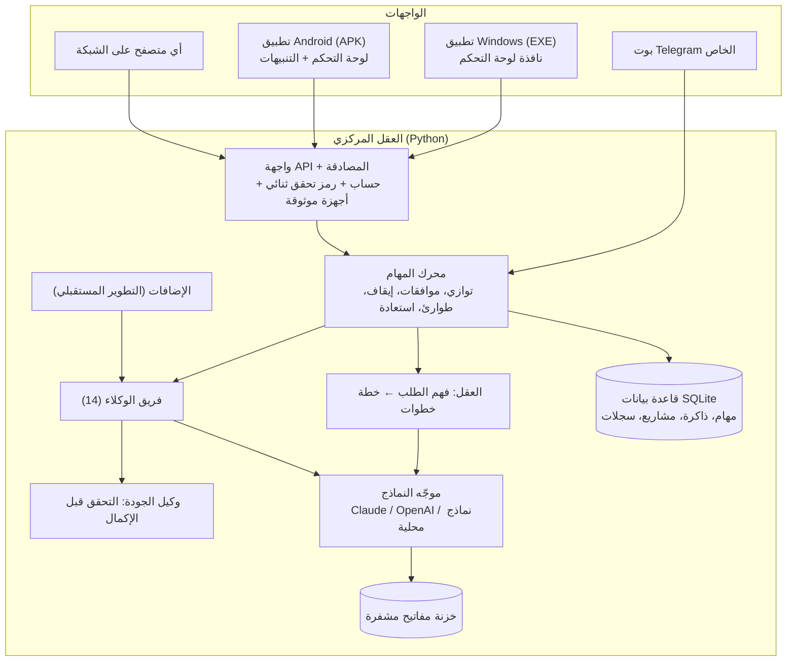
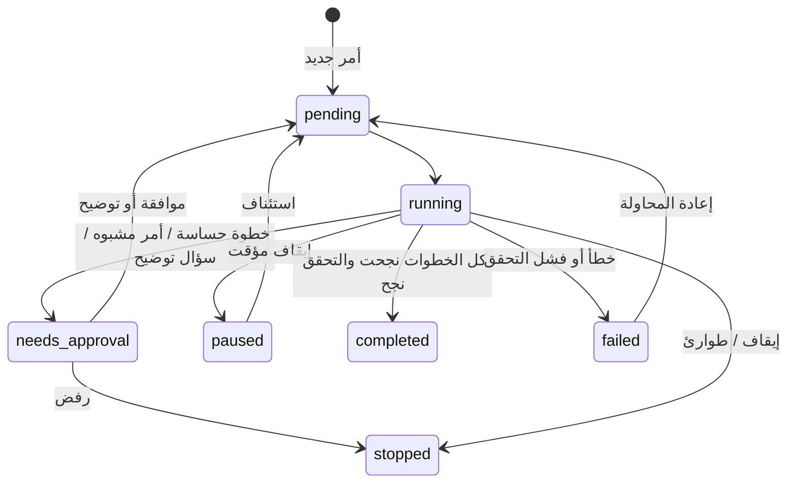

# المرحلة 1 — التخطيط المعماري الكامل

## الفكرة الأساسية: عقل واحد مشترك

النظام مبني حول **عقل مركزي واحد** (خادم صغير) يعمل على الكمبيوتر أو على خادم سحابي. كل الواجهات تتصل به:

لماذا هذا التصميم؟
- **المزامنة تلقائية**: الهاتف والكمبيوتر لا يحتفظان بنسختين منفصلتين، بل يقرآن ويكتبان في نفس العقل. المهمة التي تبدأها من الهاتف تراها فوراً على الكمبيوتر و Telegram.
- **الأمان في مكان واحد**: المفاتيح والصلاحيات والموافقات تُدار في العقل فقط، ولا تُنسخ إلى الهاتف.
- **يعمل بدون إنترنت** للأوامر المحلية، ومع نموذج محلي (Ollama) يعمل الفهم الكامل أيضاً بدون إنترنت.

## مكونات العقل

| المكون | الملف | الدور |
|---|---|---|
| التخزين | `ultra/db.py` | قاعدة SQLite واحدة: المهام، سجل التنفيذ، الذاكرة، المشاريع، الإعدادات، سجل العمليات |
| الحماية | `ultra/security.py` | خزنة مفاتيح مشفرة، الحساب وكلمة السر (scrypt)، التحقق الثنائي (TOTP)، الأجهزة الموثوقة، كشف الأوامر المشبوهة ومحاولات التلاعب بالتعليمات وكلمات السر |
| اللغة | `ultra/language.py` | تمييز الدارجة الجزائرية (بالحروف العربية واللاتينية) والفصحى والفرنسية والإنجليزية |
| العقل | `ultra/brain.py` | أوامر يومية تُفهم بدون نموذج + تخطيط بالنموذج مقيد بقائمة الإجراءات المسموحة فقط |
| النماذج | `ultra/llm.py` | اختيار النموذج حسب نوع المهمة، الانتقال لنموذج احتياطي عند الخطأ، حساب التكلفة، حد الإنفاق الشهري |
| الوكلاء | `ultra/agents.py` | 14 وكيلاً، لكل إجراء مستوى خطورة («آمن» أو «يحتاج موافقة») |
| المهام | `ultra/tasks.py` | الطابور، التوازي، الموافقات، الإيقاف المؤقت، الطوارئ، إعادة المحاولة، الاستعادة بعد الانقطاع، التحقق |
| Telegram | `ultra/telegram.py` | بوت خاص بربط برمز لمرة واحدة، أزرار موافقة، ملفات، رسائل صوتية |
| الإضافات | `ultra/plugins.py` | إضافة وكلاء وقدرات جديدة بملف واحد |
| الخادم | `ultra/server.py` | واجهة API، المراقبة، النسخ الاحتياطي، لوحة التحكم |
| الواجهة | `ultra/web/` | لوحة تحكم عربية/إنجليزية، وضع ليلي/نهاري، متجاوبة مع الهاتف |

## دورة حياة المهمة

القواعد:
1. **التحليل قبل التنفيذ**: كل أمر يتحول إلى خطة خطوات معروضة في مراقب المهام.
2. **لا إجراء خارج القائمة**: إذا اقترح النموذج إجراءً غير موجود يُحذف ويُسجل كتحذير.
3. **الموافقة قبل الحساس**: الحذف، نقل الملفات وترتيبها، حذف الذاكرة، والأوامر التي تحتوي عبارات خطرة.
4. **التحقق قبل الإكمال**: كل خطوة تتحقق من أثرها الفعلي (الملف موجود، السجل محفوظ...). إذا فشل التحقق تُعتبر المهمة فاشلة.
5. **الاستعادة**: عند انقطاع الكهرباء أو إعادة التشغيل تستمر المهمة من أول خطوة لم تكتمل.
6. **زر الطوارئ** يوقف كل شيء فوراً ويمنع بدء مهام جديدة حتى تستأنف النظام.

## فريق الوكلاء

| الوكيل | الحالة الآن | ملاحظات |
|---|---|---|
| المدير العام | يعمل | التخطيط، المحادثة، الذاكرة |
| البحث | يعمل | إجابات، تحليل صور وملفات PDF/Word/نص، بحث ويب عبر Claude عند تفعيله |
| البرمجة | يعمل جزئياً | يكتب الكود ويحفظه، ولا يشغّله تلقائياً لأسباب أمان |
| الملفات | يعمل | داخل مجلد مساحة العمل فقط، مع سلة محذوفات ونسخ سابقة |
| الأعمال | يعمل | المشاريع، المهام، المواعيد، التقارير، كتابة المستندات |
| الحماية | يعمل | حالة النظام وسجل الأحداث الأمنية |
| الجودة | يعمل | التحقق من كل خطوة، ومراجعة اختيارية بنموذج ثانٍ |
| Telegram | يعمل | التنبيهات والأوامر |
| الصوت | جزئي | الميكروفون في لوحة التحكم (Chrome/Edge)، والرسائل الصوتية في Telegram |
| الكمبيوتر | مخطط — المرحلة 4 | |
| المتصفح | مخطط — المرحلة 4 | |
| الهاتف | مخطط — المرحلة 5 | |
| الألعاب | مخطط — المرحلة 9 | بدون أي تجاوز لأنظمة مكافحة الغش |
| المنزل الذكي | مخطط — المرحلة 9 | عبر Home Assistant |

## اختيار النماذج

كل نوع مهمة (تخطيط، محادثة، بحث، كتابة، برمجة، رؤية، مراجعة) له قائمة نماذج مرتبة. يستعمل النظام أول نموذج متوفر، وإذا فشل أو رفض الطلب ينتقل للتالي.

الافتراضي: Claude Opus 5.5 أولاً، ثم OpenAI، ثم نموذج محلي عبر Ollama. يمكنك تغيير الترتيب ومستوى التفكير لكل نوع من صفحة «النماذج والتكاليف» (مثلاً وضع `anthropic:claude-haiku-5-5` أولاً في «المحادثة» لتقليل التكلفة).

## المنصات

| المنصة | كيف تعمل | البناء |
|---|---|---|
| Windows 10/11 | برنامج تثبيت يضع العقل + نافذة لوحة التحكم، مع خيار التشغيل التلقائي في الخلفية | PyInstaller + Inno Setup على GitHub Actions (جهاز Windows حقيقي) |
| Android 8+ | تطبيق يتصل بالعقل على الكمبيوتر، ويعرض لوحة التحكم ويرسل تنبيهات المهام | Gradle على GitHub Actions + اختبار على محاكي Android |
| Telegram | قناة تحكم إضافية | جزء من العقل |
| أي متصفح | لوحة التحكم نفسها | — |
